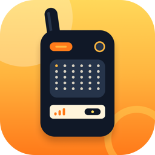

<p align="center">
  
</p>

# Walky Talky

A self-hosted, end-to-end encrypted 1:1 chat app for iOS, built on Firebase (Auth, Firestore, Storage). No central operator reads your messages or media — encryption keys are derived on-device via an offline QR handshake and never leave the device.

This project is open source (MIT) for anyone who wants to run their own instance. There is no shared/hosted "walkytalky service" — every deployer stands up their own Firebase project and owns their own data.

<p align="center">
  <a href="https://www.youtube.com/watch?v=uIOiFIBFjlQ">
    
  </a>
</p>

## Do you love this project? Sponsor it!

Your sponsorship pays for WalkyTalky maintainence and for building new features.

<p align="center">
<a href="https://github.com/sponsors/pkminhas"></a>
  <a href="https://ko-fi.com/pkminhas"></a>
</p>


## Table of contents

- [Features](#features)
- [Architecture at a glance](#architecture-at-a-glance)
- [Self-hosting guide](#self-hosting-guide)
- [Admin workflows](#admin-workflows-console-only)
- [Development](#development)
- [Known limitations](#known-limitations)
- [License](#license)

## Features

**Identity & access**
- Anonymous sign-in (Firebase Auth) — no email, no phone number, no personal identifiers required
- Single-device enforcement: an account can only be active on one device at a time, tracked via a Firestore transaction
- Local 6-digit passcode lock, hashed with PBKDF2-HMAC-SHA256 (100k iterations, per-device random salt) and stored only in the iOS Keychain — never Firestore, never plaintext
- Exponential lockout after failed passcode attempts — the first two wrong guesses get an immediate retry, the third (and every one after) starts the curve (5s / 30s / 2min / 10min / 30min cap), state kept in the Keychain so it survives an app kill
- The app locks immediately when minimized — no grace period

**Messaging**
- 1:1 conversations, admin-paired (see [Admin workflows](#admin-workflows-console-only))
- End-to-end encrypted text and media: X25519 ECDH + HKDF-SHA256 key derivation, AES-256-GCM per message
- Offline pairing via QR code — the shared key is derived entirely on-device from an ECDH exchange, never transmitted or seen by the server
- Re-pairing generates a new key version and discards the old one (old messages become permanently undecryptable — this is deliberate, not a bug)
- Delete for me / delete for everyone (sender-only, unrestricted by time), with tombstoned "This message was deleted" bubbles
- Read receipts (double-checkmark, sender's own messages only)
- Admin-assignable per-conversation display names, since accounts have no profile/email to show
- Links in messages are tappable and open in a private in-app browser (`WKWebView` with a non-persistent data store) instead of Safari — cookies, cache, and history live only in memory for that one page view and are never written to disk or shared with the system's Safari history
- Occasional background check for new messages (`BGTaskScheduler`), posting a local notification — always the fixed text "You have a new message," never a preview, since this check never decrypts anything. Deliberately not real push: Push Notifications is one of the capabilities Apple gates behind a paid Apple Developer Program membership, which would contradict this project's free-Apple-ID self-hosting promise below. The tradeoff is real — iOS gives this no guaranteed schedule (opportunistic, can be delayed hours, and is cancelled if the user force-quits the app) — see [Known limitations](#known-limitations)

**Media**
- Photo capture (camera) and picking (photo library or the Files app — iCloud Drive, "On My iPhone," any other file provider), plus GIFs
- EXIF/GPS metadata stripped from every image before it ever leaves the device
- Non-GIF images are downscaled to a 4K (3840px) long edge and normalized to JPEG @ 95% before encryption — aspect ratio preserved, never upscaled
- Decrypted media renders from an app-private sandbox only — never the system Photos library, until the user explicitly shares/saves it
- Media is cached on disk only in its original encrypted form, per conversation. It's decrypted on demand when displayed or shared, and the decrypted bytes are kept in memory only, never written to disk by the app. The in-memory copy is cleared whenever the app goes to the background
- If a user is removed from a conversation, or the conversation is deleted on the server, that conversation's cached media and its encryption key are deleted from their device once the app next gets the conversation list from the server (immediately if it's open and online, otherwise on the next launch with a connection). Being added back requires pairing again
- Fullscreen viewer: pinch-to-zoom, drag-to-pan, and a Share button (system share sheet — AirDrop, Messages, Save Image, etc.)
- Media gallery: a grid of square thumbnails for every photo/GIF in a conversation (toolbar button in the thread view), with a paged swipe viewer to move between them
- "No Face" mode: an optional per-conversation toggle (toolbar button) that runs on-device face detection (Vision) and blurs every detected face in a photo/GIF before it's encrypted and sent. Purely local to the device that enables it — not synced to Firestore, not visible to the other participant, has no effect on media they send. Fails closed: if blurring itself fails while the mode is on, the send is aborted rather than uploading an unprotected original

**UI**
- WhatsApp-style chat list and thread views: bubbles, tails, date separators, live last-message previews and timestamps

## Architecture at a glance

- **Client**: SwiftUI, iOS. No custom backend server — Firebase is the only backend.
- **Auth**: Firebase Auth, anonymous provider only.
- **Data**: Cloud Firestore (`conversations/{id}`, `conversations/{id}/messages/{id}`, `conversations/{id}/displaynames/{uid}`, `users/{uid}`), Firebase Storage for encrypted media blobs.
- **Crypto**: CryptoKit (X25519, HKDF-SHA256, AES-256-GCM, PBKDF2-HMAC-SHA256 built on `HMAC<SHA256>` since CryptoKit has no PBKDF2 API of its own).
- **Security rules**: `firebase/SecurityRules/firestore.rules` and `storage.rules` scope every read/write to real participant membership, verified server-side — never trusting client-supplied claims. See the rules files themselves for the exact logic; they're deliberately readable.
- **Admin model**: conversations and per-conversation display names are created out-of-app, directly in the Firebase console (or via a script against the Admin SDK) — there is no in-app "add contact" flow. This is a deliberate scope boundary, not a missing feature.

### Wire protocol (for anyone building a compatible client, e.g. Android)

If you're building another client against the same backend, these are the exact primitives and byte layouts messages must match to interoperate:

- **QR pairing payload**: JSON `{"conversationId": "<string>", "publicKey": "<base64, raw 32-byte X25519 public key>"}`
- **Key derivation**: `HKDF-SHA256(ECDH(myPrivateKey, peerPublicKey), salt: UTF-8(conversationId), info: UTF-8("walkytalky-conversation-key"), length: 32 bytes)`
- **Message encryption**: AES-256-GCM, random 12-byte nonce. The nonce is stored separately (base64) in the Firestore `nonce` field; the uploaded/stored payload (Storage blob for media, `text` field for text) is `ciphertext || 16-byte GCM tag` concatenated, base64-encoded for Firestore fields.

## Self-hosting guide

Self-hosting means standing up your own Firebase project — there's no separate server to run. Everyone who wants their own instance does this once.

### Prerequisites

- A Mac with Xcode 26.6+ (project targets iOS 26.0; lower it in the Xcode project settings if you need to support older devices, but this hasn't been tested below that)
- An Apple ID (free tier is enough to build and run on your own devices/simulator; a paid Apple Developer Program membership is only needed for TestFlight/App Store distribution)
- A Google account, for Firebase
- [Firebase CLI](https://firebase.google.com/docs/cli) (`npm install -g firebase-tools`)

### 1. Create your Firebase project

1. Go to the [Firebase console](https://console.firebase.google.com) and create a new project.
2. **Authentication** → Sign-in method → enable **Anonymous**.
3. **Firestore Database** → create a database (Native mode — this is required, not the legacy Datastore mode).
4. **Storage** → set up a default bucket.
5. **Project settings** → add an iOS app. Use your own bundle identifier (the repo defaults to `com.withpreet.walkytalky` — change this to something you own before building for a real device, since bundle IDs must be unique per Apple Developer team).
6. Download the generated `GoogleService-Info.plist` and place it at `ios/walkytalky/walkytalky/GoogleService-Info.plist` (this path is already gitignored — never commit it).

### 2. Point the Firebase CLI at your project

```bash
cd firebase
firebase login
```

Edit `.firebaserc` and replace the project ID with your own:

```json
{
  "projects": {
    "default": "your-project-id"
  }
}
```

### 3. Deploy the security rules

```bash
firebase deploy --only firestore:rules,storage
```

Read `firebase/SecurityRules/firestore.rules` and `storage.rules` first — they're the actual access-control boundary for your data. Don't deploy rules you haven't read.

### 4. Configure and build the iOS app

1. Open `ios/walkytalky/walkytalky.xcodeproj` in Xcode.
2. Select the `walkytalky` target → Signing & Capabilities → set your own Team and Bundle Identifier (must match what you registered in step 1.5).
3. Build and run on a simulator or your own device.

### 5. Pair your first conversation

See [Admin workflows](#admin-workflows-console-only) below — you'll need at least two signed-in accounts (two devices, or two simulators) and a manually-created conversation doc before there's anything to chat in.

## Admin workflows (console-only)

There is no in-app way to add a contact or start a new conversation — this is intentional, not a missing feature (see `chat-app-task-list.md` for the original design rationale). An admin does the following directly in the Firebase console (Firestore Database tab):

1. **Get each user's uid.** Each user can find their own via the app's toolbar menu → "My User ID" (or the empty chat-list screen, which surfaces it directly).
2. **Create the conversation.** Add a document to the `conversations` collection with:
   ```json
   { "participants": ["<uidA>", "<uidB>"] }
   ```
3. **(Optional) Assign display names.** Since accounts have no email/profile, the chat list otherwise falls back to showing a truncated uid. Add a doc per participant at `conversations/{conversationId}/displaynames/{uid}`:
   ```json
   { "displayId": "AB" }
   ```
4. **Pair the devices.** Both users open the new conversation and use the in-app QR pairing flow (one shows their QR code, the other scans it) — this is a real-time, in-person or video-call step; the encryption key is derived entirely on-device and never touches the server.

## Development

```bash
cd ios/walkytalky

# Build
xcodebuild -project walkytalky.xcodeproj -scheme walkytalky \
  -destination 'generic/platform=iOS Simulator' -configuration Debug build

# Run the unit test suite
xcodebuild -project walkytalky.xcodeproj -scheme walkytalky \
  -destination 'id=<simulator-udid>' -only-testing:walkytalkyTests test

# Run the UI tests (real tap-through tests against a live Firebase backend —
# these need a booted, freshly-erased simulator to be reliable)
xcodebuild -project walkytalky.xcodeproj -scheme walkytalky \
  -destination 'id=<simulator-udid>' -parallel-testing-enabled NO \
  -only-testing:walkytalkyUITests test
```

Project layout:

```
ios/walkytalky/walkytalky/
  Auth/           sign-in, device-conflict handling, auth state
  Passcode/       local passcode lock, PBKDF2, lockout
  Conversations/  chat list, thread view, messages, display names
  Pairing/        X25519 identity, QR generation/scanning, key derivation
  Media/          capture, EXIF stripping, resize, encrypt/decrypt, upload/download
  Models/         Firestore-mirrored data models, Keychain wrapper
firebase/
  SecurityRules/  firestore.rules, storage.rules — read these before deploying
  firebase.json, .firebaserc
```

`chat-app-task-list.md` is the full build log — every phase, every decision, every bug found and fixed, with dates. It's the most detailed record of *why* the code looks the way it does.

## Known limitations

- **Two participants per conversation, by design.** The E2E encryption is a single AES key derived from a pairwise ECDH exchange — it mathematically cannot extend past two people without a different key-agreement scheme (e.g. Signal-style sender keys). Adding a third participant to a conversation's `participants` array will break decryption for everyone in it, not just the third person.
- **No in-app contact discovery or conversation creation.** Deliberate scope boundary — see [Admin workflows](#admin-workflows-console-only).
- **No real push notifications, on purpose.** The background message check is opportunistic only — iOS decides if and when it actually runs (commonly hours apart, and cancelled entirely if you force-quit the app from the app switcher). This is a deliberate tradeoff to avoid requiring a paid Apple Developer Program membership (Push Notifications is gated behind one) just to self-host your own instance.
- **No video support yet.**
- **No group chat.**
- **iOS only, for now.** See below.

## License

MIT — see [`LICENSE`](LICENSE).
